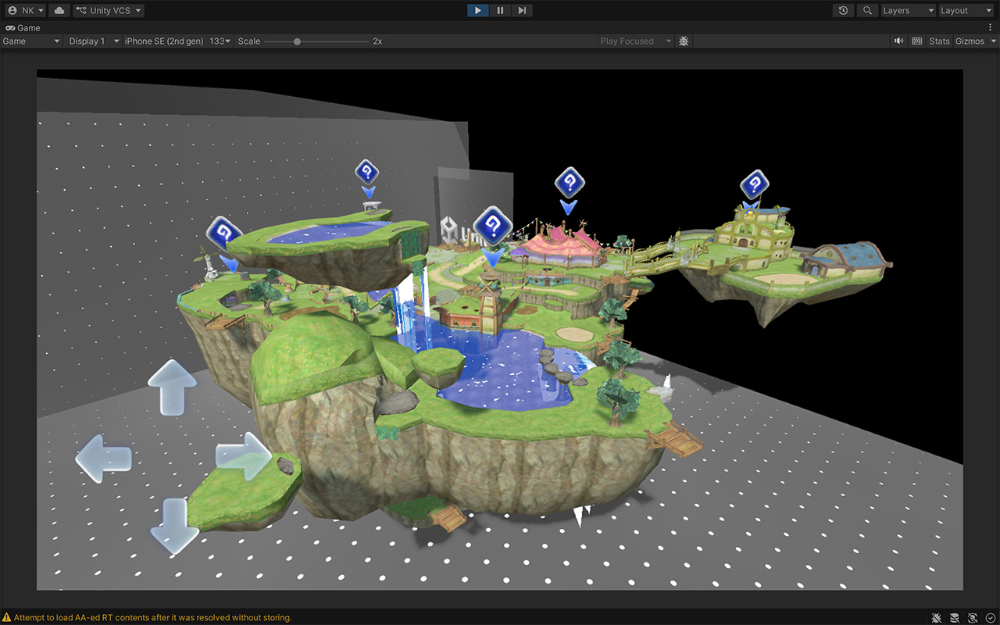
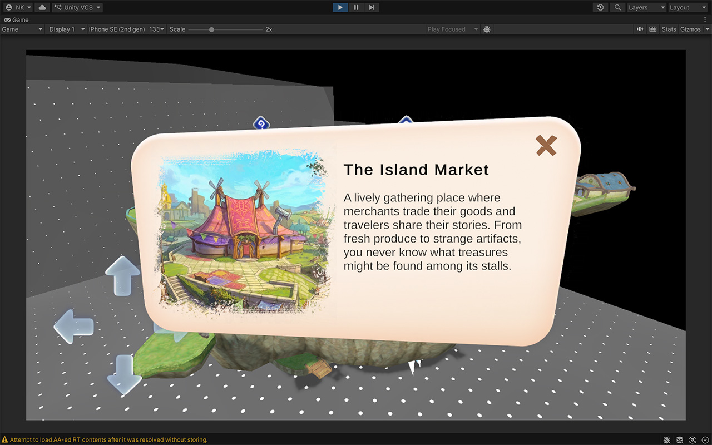
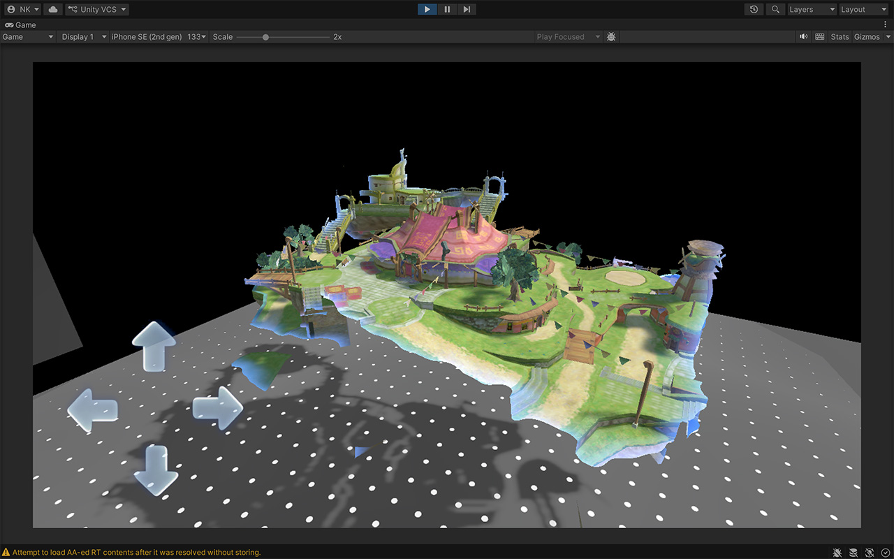
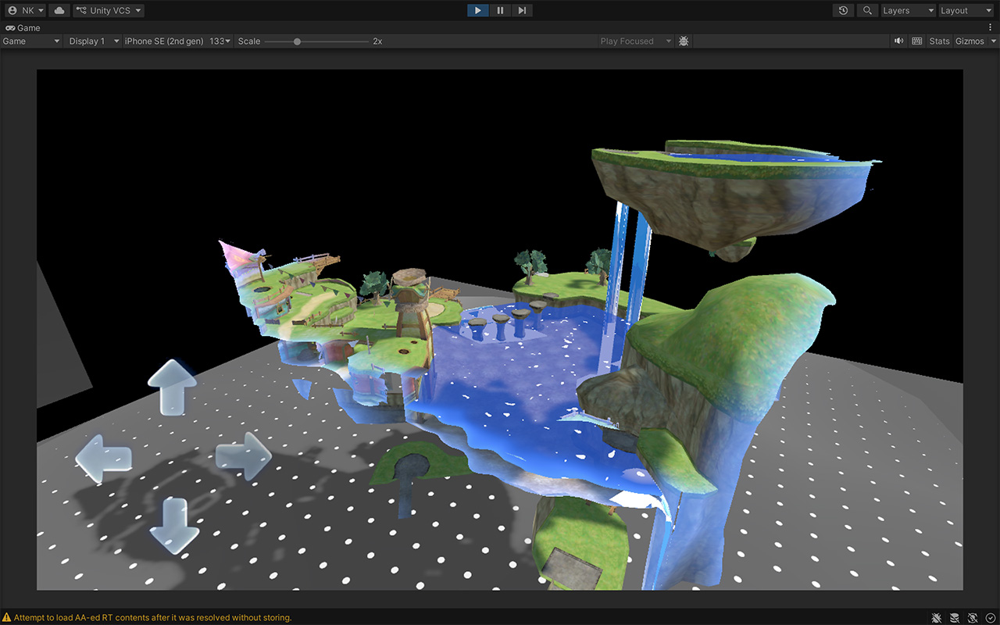
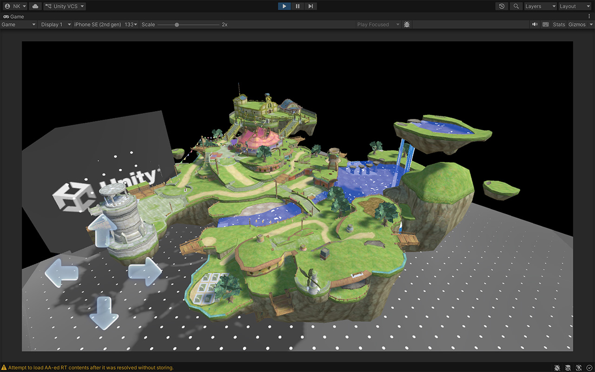

# Augmented Reality Lab

A personal side project built in Unity to experiment with AR systems and interaction design. It's a sandbox for trying out ideas, from rendering and shaders to navigation and input, in an augmented reality context.

## Project Framing

This is an experimental R&D project rather than a production-ready product. It's developed in my spare time, with no fixed roadmap, to build hands-on experience with Unity's AR tooling and to explore what feels good to interact with in AR.

## Installation

Not available yet since the project is still in development. The setup instructions will be added once a first usable build is ready.

## Log

**16 september 2026**

Added a pointer above models, plus a dialog showing a description of the selected model.

---

**12 september 2026**

Added a shader to crop the island, along with simple arrow-based navigation (to be replaced by a joystick in the future).

---

**3 september 2026**

Imported the island model.

